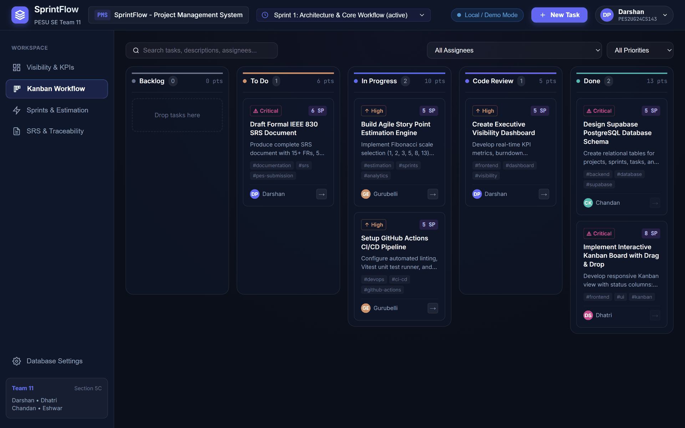
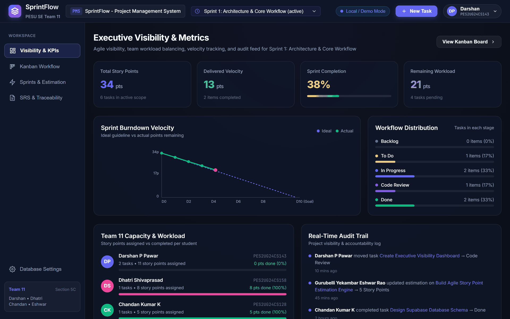
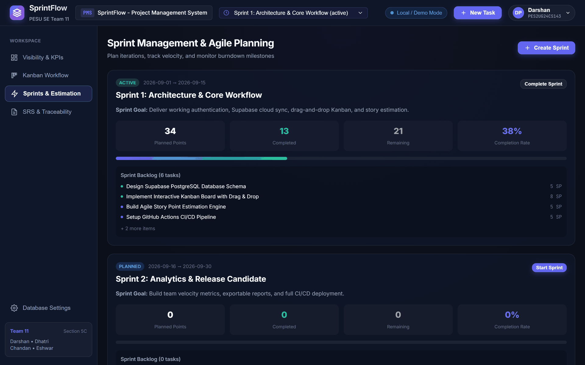
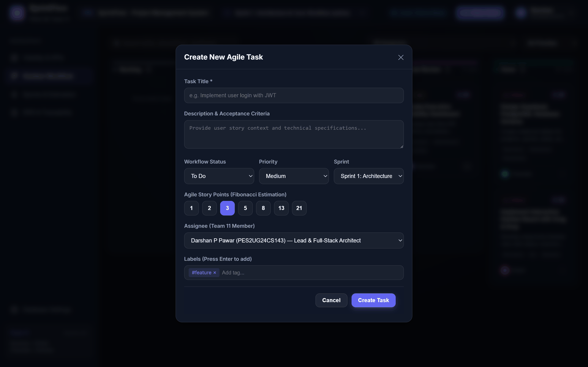
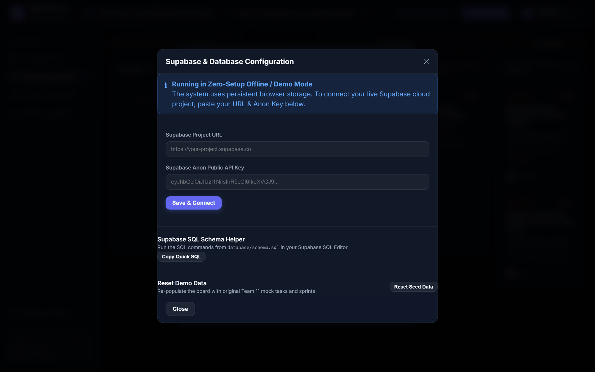

# SprintFlow: Agile Project Management System

**Course:** Software Engineering (5th Semester B.Tech, Section 5C)  
**Institution:** PES University, Department of Computer Science and Engineering  
**Academic Year:** 2025-2026  
**Team Designation:** Team 11  
**Project Focus:** Workflow Automation, Executive Visibility, Agile Estimation, and Kanban  

[](https://github.com/Darshanpawar7/SE-SRS/actions)

SprintFlow is a high-performance web-based Agile Project Management System developed by Team 11. The application provides end-to-end support for iterative software engineering workflows, including interactive 5-column Kanban board management with HTML5 drag-and-drop mechanics, Fibonacci story point estimation, sprint scheduling, real-time SVG burndown velocity tracking, executive visibility dashboards, and dual-mode database synchronization via Supabase PostgreSQL and persistent offline fallback storage.

This is the single repository for the whole project: the source code, the SRS (Phase 1), the SAD and STP (Phase 2), and the sprint work tracked through Issues, Pull Requests and Actions. Phase 2 was first developed in the separate [SE-SRS-2](https://github.com/Darshanpawar7/SE-SRS-2) repository. Its complete commit history was merged here on 26 October 2026, and SE-SRS-2 is kept for reference only. All new work happens in this repository.

---

## 1. Team Members and Work Allocation

| Student Name | USN | Engineering Role | Phase 1 Branch (SRS) | Phase 2 Branch (SAD / STP) |
|---|---|---|---|---|
| **Darshan P Pawar** | `PES2UG24CS143` | Team Lead & Full-Stack Architect | `feature/darshan-core-auth-dashboard` | `feature/darshan-sad-architecture` |
| **DHATRI SHIVAPRASAD** | `PES2UG24CS158` | Frontend & UI/UX Lead | `feature/dhatri-kanban-workflow` | `feature/dhatri-sad-design-ux` |
| **CHANDAN KUMAR K** | `PES2UG24CS128` | Backend & Database Architect | `feature/chandan-database-architecture` | `feature/chandan-test-plan-core` |
| **GURUBELLI YEKAMBAR ESHWAR RAO** | `PES2UG24CS173` | Full-Stack & QA/DevOps Lead | `feature/eshwar-sprint-estimation-cicd` | `feature/eshwar-test-execution-metrics` |

The detailed work breakdown, SAD and STP section ownership, and viva guide are in [docs/Team_Work_Division.md](docs/Team_Work_Division.md).

---

## 2. Academic Documentation and Deliverables

### Phase 1 -- Software Requirements Specification (SRS)

- **Project Report (PDF):** `Team11_Project_Report.pdf` (11-page formal submission document)
- **Project Report (Word):** `docs/Team11_Project_Report.docx`
- **SRS Markdown Specification:** `docs/SRS_Document_Team11.md`
- **Requirements Traceability Matrix:** Contained in Section 8 of the SRS document
- **UML Use-Case Diagrams:** `docs/uml_usecase_workflow.png`, `docs/uml_usecase_sprint_estimation.png` (black-and-white versions alongside)
- **Technical Guides:** `docs/KANBAN_WORKFLOW_GUIDE.md`, `docs/DATABASE_INTEGRATION_GUIDE.md`, `docs/AGILE_ESTIMATION_AND_CICD.md`

### Phase 2 -- Software Architecture & Design (SAD) and Software Test Plan (STP)

| Document | Description | Location |
| :--- | :--- | :--- |
| **Software Architecture & Design (SAD)** | Architecture patterns, UML component diagram, sequence diagrams, API design, security architecture (STRIDE), and technology stack documentation | `docs/SAD_Document_Team11.md` |
| **Software Test Plan (STP)** | Test strategy, test items, features to be tested, test environment, schedule, roles, traceability matrix, metrics, and security validation procedures | `docs/STP_Document_Team11.md` |
| **Architecture Decision Records** | The key design decisions behind the SAD and their rationale | `docs/ARCHITECTURE_DECISION_RECORDS.md` |
| **UX Design Specification** | User experience and interaction design | `docs/UX_DESIGN_SPECIFICATION.md` |
| **Test Case Specification** | Detailed test cases referenced by the STP | `docs/TEST_CASE_SPECIFICATION.md` |
| **Test Execution Report** | Test execution results, metrics and the CI/CD pipeline | `docs/TEST_EXECUTION_AND_CICD.md` |
| **UML Diagrams** | Component diagram and two sequence diagrams | `docs/uml_component_diagram.png`, `docs/uml_sequence_auth_task.png`, `docs/uml_sequence_sprint_burndown.png` |

| Formal Submission Report | File |
| :--- | :--- |
| SAD Report (PDF) | `Team11_SAD_Report.pdf` |
| STP Report (PDF) | `Team11_STP_Report.pdf` |
| SAD Report (Word) | `docs/Team11_SAD_Report.docx` |
| STP Report (Word) | `docs/Team11_STP_Report.docx` |

### Sprint 1 -- Implementation (19-23 October 2026)

- **Sprint 1 Demo Video (57 seconds):** [`docs/demo/SprintFlow_Sprint1_Demo.webm`](docs/demo/SprintFlow_Sprint1_Demo.webm), a captioned walkthrough of every Sprint 1 backlog item in the merged build
- **Sprint Backlog:** `docs/BACKLOG.md`, tracked on the [SprintFlow Backlog project board](https://github.com/users/Darshanpawar7/projects/1)
- **Verification Notes:** `docs/ISSUE_*_VERIFICATION.md`, one per backlog item (what changed, its automated tests and a manual check)

### Common to All Phases

- **Team Work Breakdown and Viva Guide:** `docs/Team_Work_Division.md`
- **Individual Contribution Records:** `docs/CONTRIBUTION_*.md`
- **Application Screenshots:** `docs/APPLICATION_SCREENSHOTS.md` (each screen mapped to its SRS requirements, SAD components and test cases)
- **Database DDL Schema:** `database/schema.sql`
- **CI/CD Workflow Definition:** `.github/workflows/ci.yml`
- **Course Templates and Guides:** the `.docx`, `.pdf` and `.pptx` files in the repository root

---

## 3. System Architecture

The application adopts a decoupled, reactive architecture:
- **Presentation Layer:** React 18 single-page application bundled with Vite 5.
- **State and Context Management:** React Context API (`AuthContext`, `ProjectContext`) managing reactive mutations and audit logging.
- **Data Persistence Layer:** Dual-mode storage architecture (`src/services/supabaseClient.js`) providing live PostgreSQL synchronization through `@supabase/supabase-js` v2 and resilient offline browser persistence (`localStorage`) for zero-configuration evaluation.
- **Verification and Automation:** Vitest automated test runner paired with GitHub Actions CI/CD workflows gating pushes and pull requests.

```
+-----------------------------------------------------------------------+
|                      React 18 Single Page App (Vite 5)                |
|  - Kanban Workflow   - Visibility Dashboard   - Sprint Management     |
+-----------------------------------------------------------------------+
                                  |
                                  v
+-----------------------------------------------------------------------+
|                     Dual-Mode Data Service Layer                      |
|                (src/services/supabaseClient.js)                       |
+-----------------------------------------------------------------------+
            |                                           |
            v                                           v
+-----------------------+                   +---------------------------+
| Supabase PostgreSQL   |                   | Persistent Offline Engine |
| Cloud Database (RLS)  |                   | (Browser LocalStorage)    |
+-----------------------+                   +---------------------------+
```

### Architecture Pattern

**Layered Component Architecture** was chosen for the following reasons:
- Clear separation of concerns between presentation, state management, and data access
- React component composability enables independent module development by each team member
- Dual-mode data layer provides resilient operation (cloud sync with offline fallback)

### Technology Stack

| Layer | Technology | Version |
| :--- | :--- | :--- |
| Frontend Framework | React | 18.x |
| Build Toolchain | Vite | 5.x |
| State Management | React Context API | Built-in |
| Cloud Database | Supabase PostgreSQL | Latest |
| Offline Persistence | Browser LocalStorage | Web API |
| Unit Testing | Vitest | 2.x |
| CI/CD | GitHub Actions | Latest |
| Security | Row Level Security (RLS), TLS 1.3 | -- |

---

## 4. Core System Features

1. **Interactive 5-Column Kanban Board:** Full workflow progression through `Backlog`, `To Do`, `In Progress`, `Code Review`, and `Done` with sub-50ms HTML5 drag-and-drop state updates and 1-click step advancement.
2. **Agile Fibonacci Estimation:** Story point assignment utilizing standard Fibonacci values (`1, 2, 3, 5, 8, 13, 21`) with dynamic capacity calculations.
3. **Sprint Lifecycle and Burndown Tracking:** Iteration scheduling, goal definition, and dynamic SVG burndown visualizers comparing ideal trajectory against actual velocity.
4. **Executive Visibility KPI Dashboard:** Real-time metrics for total story points, completed velocity, remaining load, and student workload distribution.
5. **Security and Access Control:** PostgreSQL Row Level Security (RLS) policies, client-side input sanitization against XSS, and TLS 1.3 encryption.
6. **Automated CI/CD Pipeline:** GitHub Actions workflow executing build checks, Vitest test suites, linting, and dependency security audits on every branch push and pull request.

---

## 5. Application Screenshots

Captured from the running production build in its default zero-configuration mode, with no
database credentials supplied. Each screen is mapped to the SRS requirements it satisfies,
the SAD components that implement it, and the test cases that verify it in
[docs/APPLICATION_SCREENSHOTS.md](docs/APPLICATION_SCREENSHOTS.md).

### 5.1 Kanban Workflow Board

Five lifecycle columns with drag-and-drop transitions, 1-click stage advancement, story
point subtotals, tags, and combined assignee, priority and free-text filtering.
Evidences PMS-F-002, PMS-F-003, PMS-F-004, PMS-F-005, PMS-F-007 and PMS-F-017.



### 5.2 Executive Visibility Dashboard

Sprint KPIs, the SVG burndown curve comparing ideal trajectory against actual points
remaining, workflow distribution, per-student capacity, and the immutable audit trail.
Evidences PMS-F-009, PMS-F-011, PMS-F-012, PMS-F-013 and PMS-F-014.



### 5.3 Sprint Management and Estimation

Sprint lifecycle states with goal definition, date ranges, and Fibonacci capacity totals
aggregated across assigned tasks. Evidences PMS-F-009 and PMS-F-010.



### 5.4 Task Creation and Fibonacci Estimation

Task dialog with the Fibonacci scale offered as fixed choices (1, 2, 3, 5, 8, 13, 21), so
a non-Fibonacci estimate cannot be entered. Evidences PMS-F-006, PMS-F-007 and PMS-F-008.



### 5.5 Database Configuration

The dual-mode data layer, reporting that the system is running on persistent browser
storage and accepting Supabase credentials to switch to cloud persistence.
Evidences PMS-F-015 and PMS-F-016.



---

## 6. Quick Start and Installation

### Prerequisites
- Node.js version 18.0.0 or higher
- npm version 9.0.0 or higher

### Local Setup
```bash
# Clone the repository
git clone https://github.com/Darshanpawar7/SE-SRS.git
cd SE-SRS

# Install dependencies
npm install

# Launch development server
npm run dev
```
Navigate to `http://localhost:5173` in a web browser. The system initializes immediately with pre-configured seed data.

**Signing in:** choose a Team 11 profile on the sign-in screen. In the default demo mode (no Supabase credentials) the password is that member's USN, for example `PES2UG24CS143` for Darshan P Pawar. When Supabase is configured, members sign in with their Supabase Auth accounts; if those accounts are not set up yet, choose **Use local demo mode instead** on the sign-in screen. Only the team lead can edit project details or reset the demo data (in local demo mode).

### Automated Testing
```bash
# Execute Vitest test suite
npm test

# Run the ESLint code quality gate
npm run lint

# Verify production build compilation
npm run build
```

---

## 7. Database Configuration

The application is architected to operate out-of-the-box in **Offline / Local Mode** with zero database setup required.

To connect a live Supabase PostgreSQL instance:
1. Create a project at [supabase.com](https://supabase.com).
2. Execute the DDL script located at `database/schema.sql` in the Supabase SQL Editor.
3. In the SprintFlow interface, open the **Database Settings** modal and input the Project URL and Anon Public Key.

---

## 8. Repository Structure

```
SE-SRS/
+-- .github/workflows/
|   +-- ci.yml                          # GitHub Actions CI/CD Pipeline
+-- database/
|   +-- schema.sql                      # Supabase PostgreSQL DDL Schema
+-- docs/
|   +-- SRS_Document_Team11.md          # Phase 1: Software Requirements Specification
|   +-- SAD_Document_Team11.md          # Phase 2: Software Architecture & Design
|   +-- STP_Document_Team11.md          # Phase 2: Software Test Plan
|   +-- ARCHITECTURE_DECISION_RECORDS.md
|   +-- UX_DESIGN_SPECIFICATION.md
|   +-- TEST_CASE_SPECIFICATION.md
|   +-- TEST_EXECUTION_AND_CICD.md
|   +-- KANBAN_WORKFLOW_GUIDE.md
|   +-- DATABASE_INTEGRATION_GUIDE.md
|   +-- AGILE_ESTIMATION_AND_CICD.md
|   +-- APPLICATION_SCREENSHOTS.md
|   +-- Team_Work_Division.md           # Work Breakdown & Viva Guide
|   +-- CONTRIBUTION_*.md               # Individual Contribution Records
|   +-- screenshots/                    # Application screenshots
|   +-- uml_*.png                       # UML diagrams (use-case, component, sequence)
|   +-- Team11_*_Report.docx / .pdf     # Formal reports (Word / PDF)
+-- src/
|   +-- components/                     # React UI Components
|   +-- context/                        # AuthContext, ProjectContext
|   +-- services/                       # Supabase Client & Data Service
|   +-- utils/                          # Estimation Logic & Constants
|   +-- tests/                          # Vitest Unit Test Suite
|   +-- App.jsx
|   +-- index.css
|   +-- main.jsx
+-- Team11_Project_Report.pdf           # Phase 1 SRS report
+-- Team11_SAD_Report.pdf / .docx       # Phase 2 SAD report
+-- Team11_STP_Report.pdf / .docx       # Phase 2 STP report
+-- package.json
+-- vite.config.js
+-- README.md
```

---

## 9. Related Standards

- **IEEE 830** -- Recommended Practice for Software Requirements Specifications
- **IEEE 42010** -- Systems and Software Engineering: Architecture Description
- **IEEE 829** -- Standard for Software and System Test Documentation
- **OWASP Top 10** -- Web Application Security Risks
