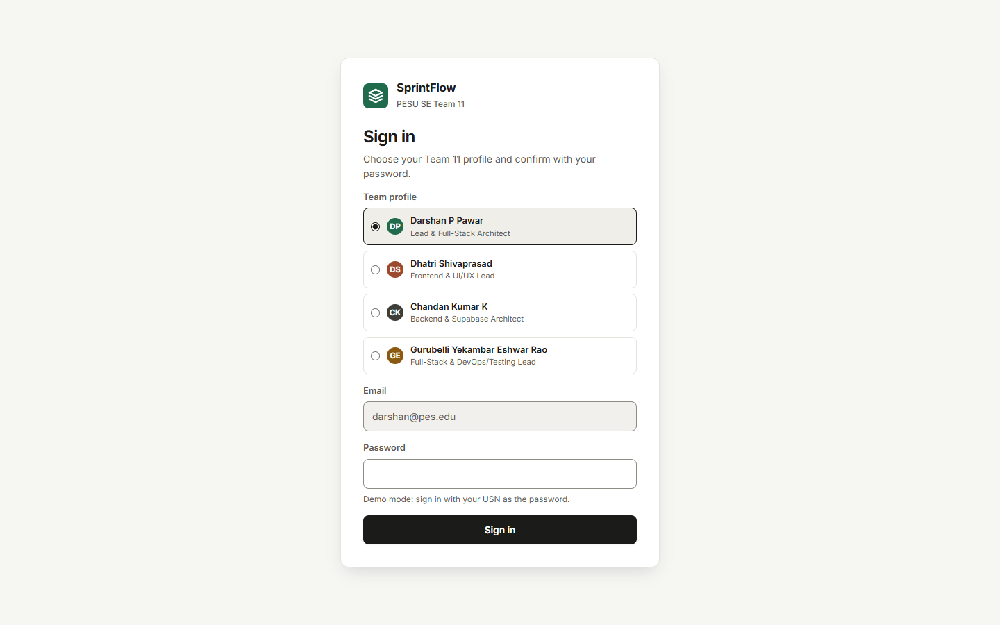
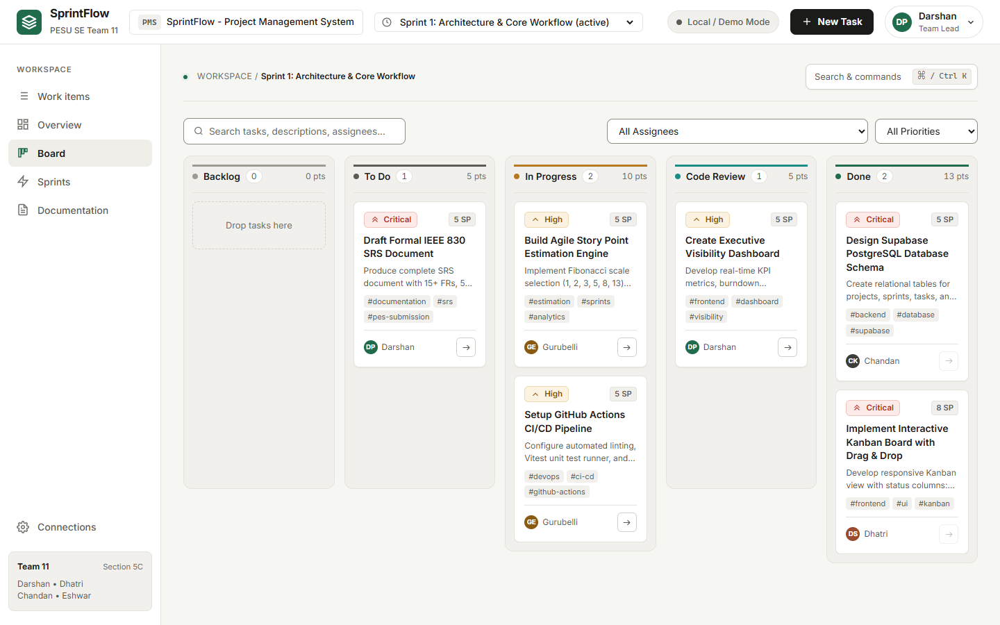
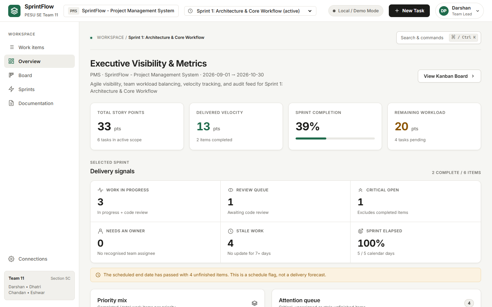
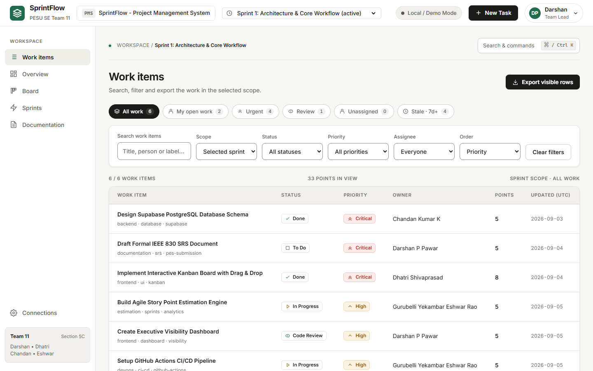

# Premium finish

Inter is bundled with the app through `@fontsource-variable/inter`, so the typeface is the same on every computer and still works offline. Page, card and dialog titles follow one type scale, numbers use tabular figures and scrollbars are thin and neutral. Plain titles replace the slogan-style headings: Work items, Delivery signals, Search and commands, and "This view could not be displayed" on the recovery screen. Work items gets a matching SVG icon in the sidebar, and the app has a tab icon instead of a missing one.

Layout fixes: sprint buttons and Documentation tabs no longer touch (the tabs form one segmented control), dialog footers span the full width, the Work items filters fit on one row at 1440px, sign-in spacing is even and the daily burndown table is styled. Task cards lift more gently, and the staggered entrance animation now works. Review at 390px, 768px and 1440px.

