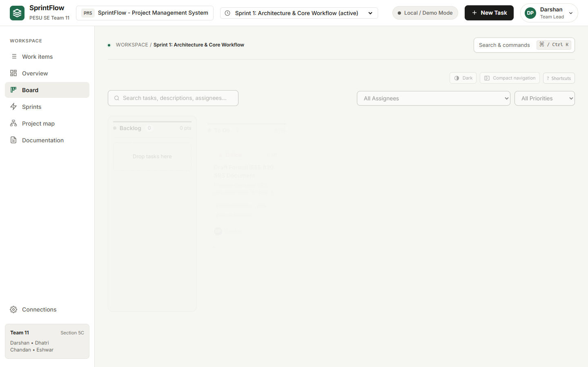
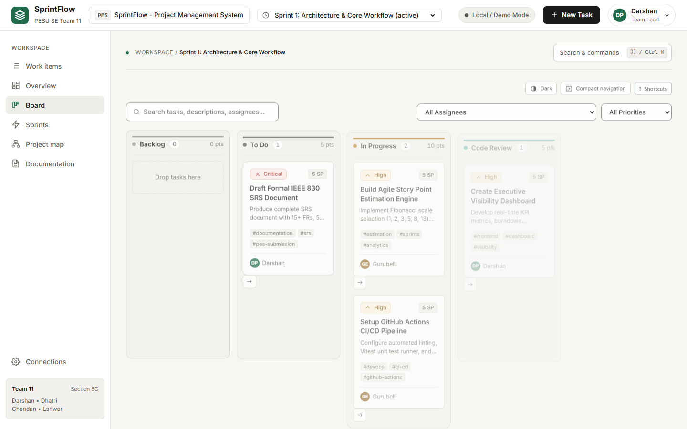
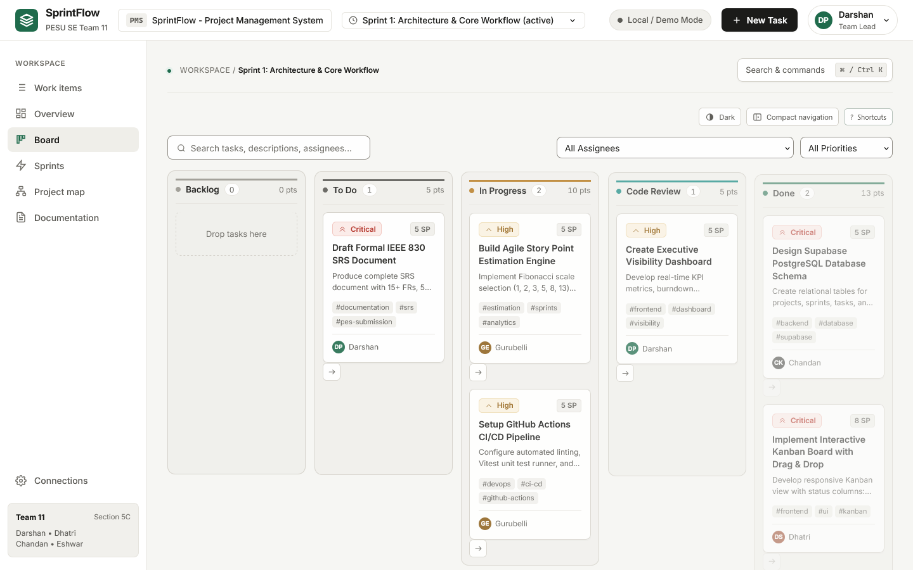

# System Validation Report

## SprintFlow -- Project Management System

**Team 11 | Section 5C | PES University**
**Owner (STP §9, Test Engineer -- Frontend):** Dhatri Shivaprasad (PES2UG24CS158) -- tracking issue #92
**Testing phase:** 2--6 November 2026 | **Executed:** 6 November 2026
**Related Documents:** `docs/STP_Document_Team11.md` (Sections 5, 13), `docs/TEST_CASE_SPECIFICATION.md`, `docs/SRS_Document_Team11.md`, `docs/SPRINT1_DEVIATIONS.md`
**PDF version (as submitted):** [Team11_System_Validation_Report.pdf](Team11_System_Validation_Report.pdf)

---

## 1. Purpose and Scope

This report validates the complete SprintFlow system against its requirements by running
every test case in the Test Case Specification end to end, in real browsers, against the
production build. It covers the system level of the Software Test Plan (STP Section 5.1),
the security validation in STP Section 5.4, and the non-functional cases in STP Section
13.2.

Unit and integration results are in the [Unit Test Report](UNIT_TEST_REPORT.md).

---

## 2. Test Environment and Approach

| Item | Value |
| :--- | :--- |
| Build under test | `main` at commit `f9e0727`, built with `npm run build` and served by `vite preview` |
| Data mode | Zero-configuration (LocalStorage) mode with the seed data in `src/services/mockData.js`. No Supabase credentials were supplied, so no test wrote to a real database. |
| Browsers | Google Chrome 157.0.8103.38 (primary), Microsoft Edge 156.0.4314.58, Firefox 142.0.1 (Playwright build) |
| Viewport | 1440 x 900 |
| Driver | Playwright 1.56.1 |
| Script | [`tests/system/system-validation.mjs`](../../tests/system/system-validation.mjs) (`npm run test:system`) |
| Raw results | [`evidence/system-validation-results.json`](evidence/system-validation-results.json) |
| Run | 6 Nov 2026, 12:07--12:09 UTC, one uninterrupted run |
| Second-machine pre-check | Build, lint, the 234 unit tests and the preview server were also checked independently on a second machine by Dhatri Shivaprasad ([`evidence/system-validation-precheck-dhatri.md`](evidence/system-validation-precheck-dhatri.md)) |

The specification marks most cases as manual. For this phase, each manual step was
written into the script as a browser action, and each expected result as a check that
compares it with what the page actually shows. This keeps the run repeatable and records
the actual result of every expected result.

- Every case starts in a fresh browser context: clean storage, the seed data, signed in as
  the Team Lead (Darshan P Pawar).
- The order of cases cannot affect the results.
- A case passes only if every check passes, as the specification requires (Section 2).
- A case whose precondition cannot be met is recorded as **Blocked**, with any steps that
  could still run.
- Each failure is saved as a screenshot.

---

## 3. Execution Summary

| Group | Cases | Pass | Fail | Blocked |
| :--- | ---: | ---: | ---: | ---: |
| Test Case Specification, functional (TC-AUTH-01 to TC-LOG-01) | 20 | 17 | 1 | 2 |
| Test Case Specification, non-functional (TC-PERF-01 to TC-RECOV-01) | 6 | 5 | 0 | 1 |
| Supplementary cases for SRS requirements with no specified case | 2 | 2 | 0 | 0 |
| Security validation, STP Section 5.4 | 5 | 4 | 0 | 1 |
| **Total** | **33** | **28** | **1** | **4** |

| Metric (STP Section 14.1) | Result | Target |
| :--- | ---: | ---: |
| Cases executed in full (pass + fail) | 29 of 33 (87.9%) | 100% |
| Cases with at least one step executed | 31 of 33 (93.9%) | -- |
| Pass rate of executed cases | 28 of 29 (96.6%) | 95% or higher |
| Pass rate after the DEF-04 fix was retested | 29 of 29 (100%) | 95% or higher |
| Open critical or high defects | 0 | 0 |

**Verdict: PASS for the zero-configuration system. Both defects found were fixed and
retested, and four cases wait on a Supabase test project.**

- Every requirement that can be exercised without a cloud database passes, except one
  usability detail in filtering (DEF-04, Section 5). Its fix in PR #98 passed retest.
- A wording slip in the workload panel (DEF-05) was fixed in PR #101, and a full
  regression run on the final build passed with no failures (Section 12).
- The cases that need a live Supabase project are listed in Section 6 and tracked in
  issue #96.

---

## 4. Results by Test Case

Requirement IDs follow the SRS, the project's baseline. The Test Plan ID for the same
feature is shown alongside it (`docs/SPRINT1_DEVIATIONS.md`, Section 1).

| # | Test case | SRS ID | Test Plan ID | Title | Result | Key evidence |
| ---: | :--- | :--- | :--- | :--- | :---: | :--- |
| 1 | TC-AUTH-01 | PMS-F-001 | PMS-F-001 | Authenticate and establish session | Pass | Top bar shows Darshan / Team Lead; still signed in after refresh |
| 2 | TC-PROJ-01 | PMS-F-002 | — | Show project metadata (supplementary) | Pass | Key PMS, project name and active sprint in the top bar; project dates 2026-09-01 → 2026-10-30 |
| 3 | TC-TASK-01 | PMS-F-006 | PMS-F-002 | Create a task with complete metadata | Pass | Card shows title, High badge, 5 SP and Dhatri; with Backlog chosen it tops Backlog; survives refresh (default column: Section 7) |
| 4 | TC-TASK-02 | PMS-F-006 | PMS-F-016 | Assign Critical priority | Pass | Badge reads "Critical" as text |
| 5 | TC-TASK-03 | PMS-F-006 | PMS-F-002 | Reject a task with an empty title | Pass | Empty: browser validation: "Please fill out this field."; one space: inline message: "Enter a task title and choose a valid priority."; 6 cards before and after |
| 6 | TC-LABEL-01 | PMS-F-007 | — | Add labels to a task (supplementary) | Pass | Pills #feature #ui #api; unchanged after refresh |
| 7 | TC-KAN-01 | PMS-F-003 | PMS-F-003 | Render the five-column board | Pass | Backlog, To Do, In Progress, Code Review, Done; every count badge matches its cards |
| 8 | TC-KAN-02 | PMS-F-004 | PMS-F-004 | Transition a task by drag-and-drop | Pass | Card in In Progress; Backlog 1 -> 0, In Progress 2 -> 3; kept after refresh |
| 9 | TC-KAN-03 | PMS-F-005 | PMS-F-005 | Advance a task by single action | Pass | To Do → In Progress; 0 enabled advance controls in Done |
| 10 | TC-KAN-04 | PMS-F-004 | PMS-F-004 | Cancel a drag outside any column | Pass | 1 dragstart, 0 drop events; card stayed in In Progress |
| 11 | TC-FILT-01 | PMS-F-017 | PMS-F-011 | Filter by priority | **Fail** | An explicit empty state names the active filters: five columns each show "Drop tasks here"; no message names the active filters |
| 12 | TC-EST-01 | PMS-F-008 | PMS-F-006 | Assign Fibonacci story points | Pass | Choices 1, 2, 3, 5, 8, 13, 21; each value saved; capacity 33 -> 49 (task 5 -> 21) |
| 13 | TC-EST-02 | PMS-F-009 | PMS-F-008 | Calculate sprint capacity | Pass | Capacity 16 with 3+5+8, then 11 after removing the 5 |
| 14 | TC-SPR-01 | PMS-F-010 | PMS-F-007 | Create a sprint | Pass | Sprint 3 listed with goal and range 2026-11-06 → 2026-11-19; offered in the task dialog |
| 15 | TC-BURN-01 | PMS-F-011 | PMS-F-009 | Update the burndown chart | Pass | Today's actual 20 -> 15 (task 5 SP); ideal line unchanged |
| 16 | TC-DASH-01 | PMS-F-012 | PMS-F-010 | Display KPI metrics | Pass | total 33, delivered 13, completion 39%, remaining 20; matches the board |
| 17 | TC-WORK-01 | PMS-F-013 | PMS-F-017 | Show workload distribution | Pass | 10 + 8 + 5 + 10 = 33; sprint total 33 |
| 18 | TC-DOCS-01 | not in SRS | PMS-F-018 | Render in-app documentation | Pass | All three tabs render (3172 characters, 1093 characters, 947 characters) |
| 19 | TC-SUPA-01 | PMS-F-015 | PMS-F-013 | Persist to Supabase PostgreSQL | Blocked | Precondition not met: needs a Supabase test project with database/schema.sql (and the 20261103 migration) applied. |
| 20 | TC-OFF-01 | PMS-F-016 | PMS-F-014 | Persist offline without configuration | Pass | 2 of 2 present after reopening the tab; top bar shows Local / Demo Mode |
| 21 | TC-SET-01 | PMS-F-015 | PMS-F-015 | Switch data mode from settings | Blocked | Step 3 passed: malformed URL rejected, offline mode kept. Steps 1–2 need a Supabase test project (Section 6) |
| 22 | TC-LOG-01 | PMS-F-014 | PMS-F-012 | Record an audit trail for mutations | Pass | Records 4 -> 7: CREATE, UPDATE, DELETE, each with user, task and timestamp |
| 23 | TC-PERF-01 | PMS-NF-001 | PMS-NF-001 | Drag-and-drop transition under 50 ms | Pass | 10 measured drops after 2 warm-ups: p50 2.3 ms, p95 6.6 ms, max 6.6 ms |
| 24 | TC-AVAIL-01 | PMS-NF-002 | PMS-NF-002 | Stay usable with the network disabled | Pass | With the network off: every view opens, a task is created, top bar shows Local / Demo Mode |
| 25 | TC-COMPAT-01 | not in SRS | PMS-NF-003 | Core workflows on Chrome, Edge and Firefox | Pass | Same results and 0 px layout drift; chrome 157.0.8103.38, edge 156.0.4314.58, firefox 142.0.1 |
| 26 | TC-SEC-01 | PMS-SR-003 | PMS-NF-004 | Encrypted transport to Supabase | Blocked | An http:// project URL is refused. Live HTTPS traffic not inspected: needs Supabase (Section 6) |
| 27 | TC-LOAD-01 | not in SRS | PMS-NF-005 | Board with 100+ tasks | Pass | Board ready 162 ms after navigation with 106 tasks; drop-to-render p95 8.9 ms over 5 drops |
| 28 | TC-RECOV-01 | PMS-NF-004 | PMS-NF-006 | No data loss across disconnect and reconnect | Pass | Tasks created offline still present after reconnect and reload (2 of 2 present) |
| 29 | SEC-XSS | PMS-SR-004 | STP 5.4 | XSS input sanitization | Pass | Script tags and event handlers in title, description and sprint goal never ran; rendered as text |
| 30 | SEC-RLS | PMS-SR-001 | STP 5.4 | Row Level Security on direct API calls | Blocked | Needs a live Supabase project to send cross-project API calls. The policies in database/schema.sql are checked statically by src/tests/databaseSecurity.test.js. |
| 31 | SEC-TOKEN | not in SRS | STP 5.4 | Session token handling | Pass | Neither the password nor any JWT is kept in browser storage |
| 32 | SEC-KEYS | PMS-SR-002 | STP 5.4 | API key exposure in the client bundle | Pass | No complete JWT or Supabase secret key in the bundle (0 found in 2 files) |
| 33 | SEC-FUZZ | PMS-SR-004 | STP 5.4 | Input validation fuzzing | Pass | 5,000-character title bounded (120 characters stored), no crash; special characters shown as typed |

Full expected-versus-actual results for every case are in [Appendix A](#appendix-a----detailed-results).

---

## 5. Defects Found

Defect IDs continue the series in `docs/TEST_EXECUTION_AND_CICD.md` (DEF-01 to DEF-03).

| ID | Found by | Severity | Summary | Issue | Status |
| :--- | :--- | :--- | :--- | :--- | :--- |
| DEF-04 | TC-FILT-01, step 2 | Low (usability) | When the board's filters match no task, the five columns show "Drop tasks here" and nothing says that filters are hiding the work or which filters are active. "Reset Filters" is shown and restores the board. | #95, fixed in PR #98 | Fixed; retest passed on 6 Nov 2026 |
| DEF-05 | Review of TC-WORK-01 evidence | Cosmetic | The Capacity & Workload panel reads "1 tasks" for a member with one task, because `WorkloadList.jsx` always prints the plural. TC-WORK-01 still passes; the totals are correct. | #100, fixed in PR #101 | Fixed; retest passed (Section 12.1) |

### DEF-04 in detail

- **Expected** (TC-FILT-01): "an explicit empty state names the active filters and offers
  to clear them; columns are not left silently blank."
- **Actual:** the High-priority filter works (step 1 passed). With a search term that
  matches nothing added (step 2), the board looks the same as an empty sprint.
- **Comparison:** the Work items view already shows "No work items match." for the same
  situation, so the board is the only place affected. No data is lost or changed.
- **Screenshot:** [`evidence/TC-FILT-01-chrome-failure.png`](evidence/TC-FILT-01-chrome-failure.png).

### DEF-04 retest (PR #98)

PR #98 (Dhatri Shivaprasad) adds a status message above the board that names the active
filters, with a Reset Filters button. Its build (commit `e8f5905`) was retested in Chrome
on 6 Nov 2026 at 21:37 IST:

- TC-FILT-01: all four checks pass. The message reads "No tasks match the active filters:
  Priority: High; Search: “no-such-task-xyz”."
- Regression: the full Chrome suite on the same build gives 29 pass, 0 fail and 4 blocked
  (the same four cloud cases).
- On the fix branch, `npm test` passes 237 of 237 tests; lint and the build succeed.
- Evidence: [`evidence/DEF-04-before-fix.png`](evidence/DEF-04-before-fix.png),
  [`evidence/DEF-04-after-fix-PR98.png`](evidence/DEF-04-after-fix-PR98.png) and
  [`evidence/system-validation-retest-PR98.json`](evidence/system-validation-retest-PR98.json).

### DEF-05 in detail

While checking the screenshots for this report we noticed that the workload panel says
"1 tasks • 8 story points assigned" (Dhatri) and "1 tasks • 5 story points assigned"
(Chandan). The text is built as `{taskCount} tasks` on lines 20 and 41 of
`src/components/dashboard/WorkloadList.jsx`. No number is affected, so TC-WORK-01 passes.
Logged as issue #100 and fixed in PR #101 (retest in Section 12.1). Screenshot:
[`evidence/screenshots/sv-workload.png`](evidence/screenshots/sv-workload.png).

No other defects were found. In particular:

- No uncaught JavaScript error occurred in any case.
- The XSS and fuzzing inputs neither executed nor crashed the page.
- Every state change survived a page refresh.

---

## 6. Blocked Cases: Need a Supabase Test Project

These cases have a precondition of a live Supabase project (STP Section 11 lists this as a
dependency). They were not run against the team's live database, because the steps write
rows to it. What could be verified without one is listed; the rest is tracked in issue #96.

| Case | SRS | Verified now | Still to run on a Supabase test project | Supporting automated evidence |
| :--- | :--- | :--- | :--- | :--- |
| TC-SUPA-01 | PMS-F-015 | -- | Create a task while connected, confirm the row in `tasks`, refresh and confirm it remains | `supabaseSync.test.js` (15 tests against a mocked client: reads, first-connection publish, column mapping, deletes, audit rows, failure handling) |
| TC-SET-01 | PMS-F-015 | Step 3: a malformed URL is rejected with "Enter a valid https:// Supabase project URL…", and the offline configuration is kept | Steps 1--2: valid credentials switch the indicator to cloud mode | `configSecurity.test.js`, `supabaseSync.test.js` (TC-SET-01 malformed-URL test) |
| TC-SEC-01 | PMS-SR-003 | A plain `http://` project URL is refused, so the client can only be configured for HTTPS | Inspect live requests: every request is HTTPS and no key appears in a URL | `configSecurity.test.js` ("accepts only HTTPS URLs…") |
| SEC-RLS | PMS-SR-001 | -- | From a second account, query another project's tasks through the REST API and expect zero rows | `databaseSecurity.test.js` ("enables RLS on every application table…") |

Before these are run, apply `database/schema.sql` and then
`database/migrations/20261103_work_signals.sql` to the test project. The migration is
needed since PR #87; without it every cloud task save is rejected.

### 6.1 Results from the Supabase test project

*To be completed under issue #96. Record each case as Pass or Fail, with the date and
what was observed.*

| Case | Date | Result | Observed |
| :--- | :--- | :--- | :--- |
| TC-SUPA-01 | | | |
| TC-SET-01 (steps 1--2) | | | |
| TC-SEC-01 | | | |
| SEC-RLS | | | |

---

## 7. Differences Between the Specification and the Built System

These are not defects: each is a documented design change, or a detail the specification
leaves open. They should be carried into the update of the Test Case Specification
(deliverable Part 1, "Test Cases Updation").

| # | Case | Specification says | System does | How it was tested |
| ---: | :--- | :--- | :--- | :--- |
| 1 | TC-TASK-01 | New card appears at the top of Backlog | A new task starts in **To Do** unless another status is chosen (documented in `SPRINT1_DEVIATIONS.md`) | Created with the default (card lands in To Do) and again with Backlog chosen (card tops Backlog). All other expected results checked on both. |
| 2 | TC-AUTH-01 | Select the Team Lead profile and confirm | Sign-in is a profile plus its password (documented in `SPRINT1_DEVIATIONS.md`) | Signed in as Darshan P Pawar (Team Lead) with the demo password |
| 3 | TC-TASK-03 | Both attempts rejected with an inline validation message | Empty title: the browser's required-field message ("Please fill out this field."). Single space: the app's inline message. | Both rejected and no task created, so the case passes. The wording should name both mechanisms. |
| 4 | TC-BURN-01 | "Note the actual burn line" | The actual line is recorded once a day per browser, so a fresh browser has a single point | Read today's value from the chart's "Daily burndown values" table, before and after completing a 5-point task |
| 5 | TC-EST-02 | "Remove the 5-point task" | -- | Removed by deleting the task |
| 6 | TC-PERF-01 | Measure with the Performance API | -- | `performance.mark` at the drop event, measured to the DOM update that shows the card in its new column; 10 samples after 2 warm-ups |
| 7 | TC-AVAIL-01, TC-RECOV-01 | Disconnect the network | -- | Network disabled in the browser context, in zero-configuration mode. The cloud retry queue across a reconnect is covered by `persistenceRecovery` and `recovery` unit tests. |
| 8 | TC-COMPAT-01 | Chrome, Firefox and Edge | -- | Desktop Firefox is not installed on the test machine, so Playwright's Firefox 142 build was used |
| 9 | Section 10 of the specification | Lists 2 automated test files | 35 unit test files (234 tests) plus this system suite | -- |
| 10 | Section 11 of the specification | -- | SRS PMS-F-002 (project metadata) and PMS-F-007 (labels) have no system case | Supplementary cases TC-PROJ-01 and TC-LABEL-01 were added; both pass |

---

## 8. Requirements Traceability (SRS Baseline)

| SRS ID | Requirement | Verified by | Result |
| :--- | :--- | :--- | :--- |
| PMS-F-001 | Sign-in and profile switching | TC-AUTH-01 | Pass |
| PMS-F-002 | Project metadata | TC-PROJ-01 (supplementary) | Pass |
| PMS-F-003 | Five Kanban columns | TC-KAN-01 | Pass |
| PMS-F-004 | Drag and drop | TC-KAN-02, TC-KAN-04 | Pass |
| PMS-F-005 | One-click stage advance | TC-KAN-03 | Pass |
| PMS-F-006 | Create and update tasks | TC-TASK-01, TC-TASK-02, TC-TASK-03 | Pass |
| PMS-F-007 | Labels and tags | TC-LABEL-01 (supplementary) | Pass |
| PMS-F-008 | Fibonacci story points | TC-EST-01 | Pass |
| PMS-F-009 | Planned points and completion | TC-EST-02, TC-DASH-01 | Pass |
| PMS-F-010 | Sprint lifecycle | TC-SPR-01; start and complete transitions in `sprintLifecycle.test.js` | Pass |
| PMS-F-011 | Burndown chart | TC-BURN-01 | Pass |
| PMS-F-012 | KPI dashboard | TC-DASH-01 | Pass |
| PMS-F-013 | Team workload | TC-WORK-01 | Pass |
| PMS-F-014 | Audit trail | TC-LOG-01 | Pass |
| PMS-F-015 | Supabase synchronisation | TC-SUPA-01, TC-SET-01 | **Blocked** (Section 6) |
| PMS-F-016 | Offline mode | TC-OFF-01, TC-AVAIL-01 | Pass |
| PMS-F-017 | Filtering | TC-FILT-01 | **Fail** in the main run, DEF-04 (Low); **Pass** on retest of the fix (PR #98) |
| PMS-F-018 | CI/CD pipeline | GitHub Actions history (Unit Test Report, Section 8) | Pass |
| PMS-NF-001 | Performance, under 50 ms | TC-PERF-01 (p95 6.6 ms), TC-LOAD-01 (p95 8.9 ms with 106 tasks) | Pass |
| PMS-NF-002 | Availability through offline fallback | TC-AVAIL-01 | Pass |
| PMS-NF-003 | Usability: contrast, Lighthouse score above 90 | No case in the specification; keyboard and screen-reader behaviour covered by `accessibility.test.jsx` | **Not measured** (Section 11) |
| PMS-NF-004 | Reliability: zero data loss across reloads and tab closures | TC-OFF-01, TC-RECOV-01, refresh steps in TC-KAN-02 and TC-TASK-01; TC-SESS-01 (supplementary, simulated Supabase, Section 12.2) | Pass |
| PMS-NF-005 | Maintainability: zero ESLint warnings, build always passes | `eslint --max-warnings=0`: 0 errors, 0 warnings; `npm run build`: succeeded (143 modules) on the same commit | Pass |
| PMS-SR-001 | Row Level Security | SEC-RLS | **Blocked** (Section 6) |
| PMS-SR-002 | No hardcoded credentials | SEC-KEYS | Pass |
| PMS-SR-003 | HTTPS / TLS 1.3 | TC-SEC-01 | **Blocked** (Section 6) |
| PMS-SR-004 | XSS input sanitisation | SEC-XSS, SEC-FUZZ | Pass |
| PMS-SR-005 | Dependency audit in CI | Dependency Security Audit workflow: 10 of 10 runs passed; `npm audit --audit-level=high`: 0 vulnerabilities | Pass |
| *(Test Plan only)* | In-app documentation viewer | TC-DOCS-01 | Pass |
| *(Test Plan only)* | Cross-browser support | TC-COMPAT-01 | Pass |
| *(Test Plan only)* | 100+ task records | TC-LOAD-01 | Pass |
| *(Test Plan only)* | Session token handling | SEC-TOKEN | Pass |

### Coverage of the SRS

- **Functional (PMS-F-001 to 018):** 16 pass, 1 fails with a low-severity defect, 1 is
  blocked.
- **Non-functional (PMS-NF-001 to 005):** 4 pass, 1 is not measured.
- **Security (PMS-SR-001 to 005):** 3 pass, 2 are blocked.

Every SRS requirement has at least one test case or piece of objective evidence.

---

## 9. Cross-Browser Compatibility (TC-COMPAT-01)

TC-KAN-01, TC-KAN-02 and TC-TASK-01 were run in each browser in a fresh context. Column
positions and widths were compared with Chrome.

| Browser | Version | TC-KAN-01 | TC-KAN-02 | TC-TASK-01 | Layout difference from Chrome |
| :--- | :--- | :---: | :---: | :---: | ---: |
| Google Chrome | 157.0.8103.38 | Pass | Pass | Pass | -- |
| Microsoft Edge | 156.0.4314.58 | Pass | Pass | Pass | 0 px |
| Firefox (Playwright build) | 142.0.1 | Pass | Pass | Pass | 0 px |

| Chrome | Edge | Firefox |
| :---: | :---: | :---: |
|  |  |  |

The three board screenshots were captured again on 6 Nov 2026 after the run, on the same
build, because the first Chrome capture was taken while the board was still fading in. The
results above are unchanged. Further screenshots for individual cases are in
[`evidence/screenshots/`](evidence/screenshots/).

---

## 10. Security Validation (STP Section 5.4)

| STP check | Case | Method | Result |
| :--- | :--- | :--- | :--- |
| XSS input sanitisation | SEC-XSS | ``, `<script>` and `<svg onload>` payloads in a task title, task description and sprint goal; a probe variable shows whether any handler ran | Pass: nothing ran; no injected element in the page |
| Row Level Security | SEC-RLS | Cross-project REST call from a second account | Blocked (Section 6); policies verified statically by `databaseSecurity.test.js` |
| TLS 1.3 enforcement | TC-SEC-01 | Inspect live traffic | Blocked (Section 6); the client refuses `http://` project URLs |
| Session token handling | SEC-TOKEN | Scan LocalStorage and SessionStorage after sign-in | Pass: neither the password nor any JWT is stored in zero-configuration mode |
| API key exposure | SEC-KEYS | Scan the production bundle for complete JWTs and Supabase secret keys | Pass: none in `dist/assets` |
| Input validation fuzzing | SEC-FUZZ | 5,000-character title; Unicode, quotes, `&`, SQL-like text and emoji | Pass: title bounded to 120 characters with no crash; special characters stored and shown as typed |

---

## 11. Exit Criteria Assessment (STP Section 5.3)

| Exit criterion | Status | Detail |
| :--- | :--- | :--- |
| 100% of planned test cases executed | **Not met** | 23 of the 26 specified cases ran in full; TC-SUPA-01, TC-SET-01 (steps 1--2) and TC-SEC-01 wait on a Supabase test project (#96) |
| 0 critical or high-severity defects open | Met | Two defects were found, neither critical nor high, and both are fixed and retested: DEF-04 (PR #98) and DEF-05 (PR #101) |
| All functional requirements verified against acceptance criteria | **Partly met** | 17 of 18 SRS functional requirements pass once the DEF-04 fix is counted; PMS-F-015 is blocked |
| All non-functional requirements measured and within threshold | **Partly met** | 4 of 5 SRS non-functional requirements measured, all within threshold. PMS-NF-003 (Lighthouse above 90) has no test case and was not measured. |
| RTM shows complete coverage | Met | Every SRS requirement maps to a test case or objective evidence (Section 8) |
| Test Summary Report reviewed and approved | Met | Reviewed and merged into `main` with the other reports (PR #97, 6 Nov 2026) |

To close the exit criteria:

1. Run Section 6 on a Supabase test project (#96).
2. Add a Lighthouse accessibility measurement for PMS-NF-003 to the Test Case
   Specification.

---

## 12. Regression on the Final Build

After the main run, four pull requests were merged on 6 November 2026: #98 (DEF-04 fix),
#99 (Dhatri's second-machine pre-check), #101 (DEF-05 fix, tooltip warning, CI on Node.js
24) and #85 (verified cloud sessions, merged after review fixes). Because #85 changes how
sign-in works, the whole suite was run again on the final `main`.

| Run | Build | Browsers | Pass | Fail | Blocked |
| :--- | :--- | :--- | ---: | ---: | ---: |
| Main run (Sections 3 to 11) | `f9e0727` | Chrome; Edge and Firefox for TC-COMPAT-01 | 28 | 1 | 4 |
| DEF-04 retest (Section 5) | `e8f5905` (PR #98) | Chrome | 29 | 0 | 4 |
| Final regression, 6 Nov 2026, 23:05 IST | `2b8fdbc` (final `main`) | Chrome; Edge and Firefox for TC-COMPAT-01 | 29 | 0 | 4 |

The final results match the main run case for case, except that TC-FILT-01 now passes.
TC-COMPAT-01 again found a 0 px layout difference, and the same four cloud cases stay
blocked. All 259 unit tests pass on the same commit. Raw results:
[`evidence/final-regression/system-validation-results-2b8fdbc.json`](evidence/final-regression/system-validation-results-2b8fdbc.json).

### 12.1 DEF-05 retest

PR #101 makes the panel say "task" for a count of one. On the final build Dhatri and
Chandan read "1 task • 8 story points assigned" and "1 task • 5 story points
assigned"; members with two tasks still read "2 tasks". TC-WORK-01 passes and issue #100
is closed. Screenshot:
[`evidence/final-regression/DEF-05-after-fix-PR101.png`](evidence/final-regression/DEF-05-after-fix-PR101.png).

### 12.2 Supplementary case TC-SESS-01: a network failure must not sign out a member

PR #85 re-checks the cloud session on Supabase auth events, for example when the tab
regains focus. In review we found that a failed check signed the member out even when only
the network had failed, which threw away any task being edited (a data-loss risk under
PMS-NF-004). The fix keeps the member on network errors and signs out only when Supabase
rejects the session. No Supabase test project is available yet, so the case was run in
Chrome against a simulated Supabase server (Playwright answered the app's Supabase
requests; no real database was used).

| Step | Expected result | Before the fix | Final build (`2b8fdbc`) |
| :--- | :--- | :--- | :--- |
| 1. Sign in to the cloud project | The workspace opens | Pass | Pass |
| 2. Type a task title; the session check fails because the network is down | Still signed in; dialog and typed title remain | **Fail**: sent to the sign-in page, draft lost | Pass |
| 3. The network comes back | Session checked again; still signed in | Not reached | Pass |
| 4. Supabase rejects the session (401) | Signed out with "Your cloud session has ended" | Not reached | Pass |

The same logic is covered by 15 unit tests in `src/tests/sessionVerification.test.js`.
Script: [`tests/system/cloud-session-check.mjs`](../../tests/system/cloud-session-check.mjs).
Screenshots:
[`evidence/final-regression/TC-SESS-01-after-network-blip.png`](evidence/final-regression/TC-SESS-01-after-network-blip.png),
[`evidence/final-regression/TC-SESS-01-after-401.png`](evidence/final-regression/TC-SESS-01-after-401.png).
This case does not replace TC-SUPA-01 on a real Supabase project (#96).

---

## 13. Conclusion

In zero-configuration mode, SprintFlow behaves as specified in Chrome, Edge and Firefox.

- **Workflow:** every specified workflow passes, including create, edit, delete,
  drag-and-drop, advance, estimate, sprint planning, burndown, dashboard, audit trail,
  offline use and recovery.
- **Performance:** drag-and-drop renders within 9 ms at the 95th percentile, even with
  106 tasks on the board.
- **Security:** no XSS payload executes and no credential is exposed.
- **Defects:** one low-severity usability defect (DEF-04) and one cosmetic wording defect
  (DEF-05). Both were fixed, retested and merged on 6 November; a full regression run on
  the final build passed with no failures (Section 12).
- **Outstanding:** the cloud-database cases need a Supabase test project before they can
  be run.

---

## Appendix A -- Detailed Results

### TC-AUTH-01 — Authenticate and establish session — PASS

SRS: PMS-F-001 · Test Plan: PMS-F-001 · Browser: chrome

| Expected result checked | Actual result | Verdict |
| :--- | :--- | :---: |
| Navigation bar shows the profile name | Darshan | Pass |
| Navigation bar shows the role | Team Lead | Pass |
| Session persists after refresh (no sign-in view) | signed in after reload | Pass |

### TC-PROJ-01 — Show project metadata (supplementary) — PASS

SRS: PMS-F-002 · Test Plan: — · Browser: chrome

| Expected result checked | Actual result | Verdict |
| :--- | :--- | :---: |
| Top bar shows the project key and name | SprintFlow PESU SE Team 11 PMS SprintFlow - Project Management System Sprint 1: Architecture & Core Workflow (active) Sp | Pass |
| Top bar shows the active sprint | Sprint 1: Architecture & Core Workflow (active) | Pass |
| Dashboard shows the project key, name and date range | 2026-09-01 → 2026-10-30 | Pass |

### TC-TASK-01 — Create a task with complete metadata — PASS

SRS: PMS-F-006 · Test Plan: PMS-F-002 · Browser: chrome

| Expected result checked | Actual result | Verdict |
| :--- | :--- | :---: |
| Card shows the title | High 5 SP Implement burndown chart #feature DS Dhatri | Pass |
| Card shows a High priority badge | High 5 SP Implement burndown chart #feature DS Dhatri | Pass |
| Card shows a 5-point estimate | High 5 SP Implement burndown chart #feature DS Dhatri | Pass |
| Card shows the assignee | High 5 SP Implement burndown chart #feature DS Dhatri | Pass |
| With Backlog chosen, the card appears at the top of the Backlog column | Implement burndown chart (Backlog) | Pass |
| Cards survive a page refresh | both present after reload | Pass |

Notes: With the default Workflow Status the card lands in "To Do". SPRINT1_DEVIATIONS.md records that a new task starts in To Do unless another status is chosen; the specification text still says Backlog.

### TC-TASK-02 — Assign Critical priority — PASS

SRS: PMS-F-006 · Test Plan: PMS-F-016 · Browser: chrome

| Expected result checked | Actual result | Verdict |
| :--- | :--- | :---: |
| Card shows a Critical badge | Critical | Pass |
| Badge carries a text label, not colour alone | Critical | Pass |

### TC-TASK-03 — Reject a task with an empty title — PASS

SRS: PMS-F-006 · Test Plan: PMS-F-002 · Browser: chrome

| Expected result checked | Actual result | Verdict |
| :--- | :--- | :---: |
| Empty title is rejected with a validation message | browser validation: "Please fill out this field." | Pass |
| Single-space title is rejected with a validation message | inline message: "Enter a task title and choose a valid priority." | Pass |
| No task is created in either case | 6 cards before and after | Pass |

### TC-LABEL-01 — Add labels to a task (supplementary) — PASS

SRS: PMS-F-007 · Test Plan: — · Browser: chrome

| Expected result checked | Actual result | Verdict |
| :--- | :--- | :---: |
| Labels show as separate pills, lower-cased and de-duplicated | #feature #ui #api | Pass |
| Labels survive a page refresh | #feature #ui #api | Pass |

### TC-KAN-01 — Render the five-column board — PASS

SRS: PMS-F-003 · Test Plan: PMS-F-003 · Browser: chrome

| Expected result checked | Actual result | Verdict |
| :--- | :--- | :---: |
| Exactly five columns in lifecycle order | Backlog, To Do, In Progress, Code Review, Done | Pass |
| Backlog shows its task count | count badge 0, cards 0 | Pass |
| To Do shows its task count | count badge 1, cards 1 | Pass |
| In Progress shows its task count | count badge 2, cards 2 | Pass |
| Code Review shows its task count | count badge 1, cards 1 | Pass |
| Done shows its task count | count badge 2, cards 2 | Pass |

### TC-KAN-02 — Transition a task by drag-and-drop — PASS

SRS: PMS-F-004 · Test Plan: PMS-F-004 · Browser: chrome

| Expected result checked | Actual result | Verdict |
| :--- | :--- | :---: |
| Card renders in In Progress on release | In Progress | Pass |
| Source column count decreases by one | 1 -> 0 | Pass |
| Target column count increases by one | 2 -> 3 | Pass |
| New state survives a refresh | In Progress | Pass |

### TC-KAN-03 — Advance a task by single action — PASS

SRS: PMS-F-005 · Test Plan: PMS-F-005 · Browser: chrome

| Expected result checked | Actual result | Verdict |
| :--- | :--- | :---: |
| Precondition: task is in To Do | To Do | Pass |
| Task moves to In Progress | In Progress | Pass |
| A task in Done cannot advance further | 0 enabled advance controls in Done | Pass |

### TC-KAN-04 — Cancel a drag outside any column — PASS

SRS: PMS-F-004 · Test Plan: PMS-F-004 · Browser: chrome

| Expected result checked | Actual result | Verdict |
| :--- | :--- | :---: |
| A drag was actually started | 1 dragstart, 0 drop events | Pass |
| Card returns to its original column | In Progress -> In Progress | Pass |
| Status is unchanged after refresh | In Progress | Pass |

### TC-FILT-01 — Filter by priority — FAIL

SRS: PMS-F-017 · Test Plan: PMS-F-011 · Browser: chrome

| Expected result checked | Actual result | Verdict |
| :--- | :--- | :---: |
| Only High priority tasks are visible | 3 visible: high, high, high | Pass |
| No task matches the combined filters | 0 cards visible | Pass |
| An explicit empty state names the active filters | five columns each show "Drop tasks here"; no message names the active filters | **Fail** |
| The empty state offers to clear the filters | "Reset Filters" button shown | Pass |

### TC-EST-01 — Assign Fibonacci story points — PASS

SRS: PMS-F-008 · Test Plan: PMS-F-006 · Browser: chrome

| Expected result checked | Actual result | Verdict |
| :--- | :--- | :---: |
| Only the seven Fibonacci values are offered | 1, 2, 3, 5, 8, 13, 21 | Pass |
| No free numeric estimate field exists | 0 numeric inputs | Pass |
| Estimate 1 persists on the card | 1 SP | Pass |
| Estimate 2 persists on the card | 2 SP | Pass |
| Estimate 3 persists on the card | 3 SP | Pass |
| Estimate 5 persists on the card | 5 SP | Pass |
| Estimate 8 persists on the card | 8 SP | Pass |
| Estimate 13 persists on the card | 13 SP | Pass |
| Estimate 21 persists on the card | 21 SP | Pass |
| The final estimate is reflected in sprint capacity | 33 -> 49 (task 5 -> 21) | Pass |

### TC-EST-02 — Calculate sprint capacity — PASS

SRS: PMS-F-009 · Test Plan: PMS-F-008 · Browser: chrome

| Expected result checked | Actual result | Verdict |
| :--- | :--- | :---: |
| Precondition: the new sprint has no tasks | 0 | Pass |
| Capacity reports 16 points for tasks of 3, 5 and 8 | 16 | Pass |
| Capacity is recomputed to 11 after removing the 5-point task | 11 | Pass |

### TC-SPR-01 — Create a sprint — PASS

SRS: PMS-F-010 · Test Plan: PMS-F-007 · Browser: chrome

| Expected result checked | Actual result | Verdict |
| :--- | :--- | :---: |
| Sprint appears in the sprint list | 1 | Pass |
| Sprint shows its goal | PLANNED 2026-11-06 → 2026-11-19 Sprint 3 View sprint Start Sprint Delete Sprint Sprint Goal: Deliver estimation engine 0 Planned Points 0 Completed 0 Remaining  | Pass |
| Sprint shows its two-week date range | 2026-11-06 → 2026-11-19 | Pass |
| Sprint is available as a task assignment target | Backlog (No Sprint) \| Sprint 1: Architecture & Core Workflow \| Sprint 2: Analytics & Release Candidate \| Sprint 3 | Pass |

### TC-BURN-01 — Update the burndown chart — PASS

SRS: PMS-F-011 · Test Plan: PMS-F-009 · Browser: chrome

| Expected result checked | Actual result | Verdict |
| :--- | :--- | :---: |
| Precondition: today has a recorded actual value | 20 | Pass |
| Task moved to Done | Done | Pass |
| Actual line falls by exactly the completed points | 20 -> 15 (task 5 SP) | Pass |
| Ideal line is unchanged | 19 ideal values compared | Pass |

Notes: Read from the chart's "Daily burndown values" table, which lists the same series the SVG draws.

### TC-DASH-01 — Display KPI metrics — PASS

SRS: PMS-F-012 · Test Plan: PMS-F-010 · Browser: chrome

| Expected result checked | Actual result | Verdict |
| :--- | :--- | :---: |
| Progress, velocity and workload are shown | total 33, delivered 13, completion 39%, remaining 20 | Pass |
| Total matches the board | board 33 pts, dashboard 33 | Pass |
| Delivered velocity matches the Done column | Done 13 pts, dashboard 13 | Pass |
| Progress equals completed points / total points | 13/33 = 39.4%, shown 39% | Pass |

### TC-WORK-01 — Show workload distribution — PASS

SRS: PMS-F-013 · Test Plan: PMS-F-017 · Browser: chrome

| Expected result checked | Actual result | Verdict |
| :--- | :--- | :---: |
| Tasks are assigned across at least three members | 10, 8, 5, 10 | Pass |
| Member totals sum to the sprint total | 10 + 8 + 5 + 10 = 33; sprint total 33 | Pass |

### TC-DOCS-01 — Render in-app documentation — PASS

SRS: not in SRS · Test Plan: PMS-F-018 · Browser: chrome

| Expected result checked | Actual result | Verdict |
| :--- | :--- | :---: |
| "Functional Requirements" tab renders readable content | 3172 characters | Pass |
| "Non-Functional" tab renders readable content | 1093 characters | Pass |
| "Traceability Matrix" tab renders readable content | 947 characters | Pass |
| Documentation has a readable heading | Software Requirements Specification (SRS) & RTM | Pass |

### TC-SUPA-01 — Persist to Supabase PostgreSQL — BLOCKED

SRS: PMS-F-015 · Test Plan: PMS-F-013 · Browser: chrome

Blocked: Precondition not met: needs a Supabase test project with database/schema.sql (and the 20261103 migration) applied.

### TC-OFF-01 — Persist offline without configuration — PASS

SRS: PMS-F-016 · Test Plan: PMS-F-014 · Browser: chrome

| Expected result checked | Actual result | Verdict |
| :--- | :--- | :---: |
| Both tasks are restored after reopening the tab | 2 of 2 present | Pass |
| Interface indicates offline (LocalStorage) persistence | Local / Demo Mode | Pass |

### TC-SET-01 — Switch data mode from settings — BLOCKED

SRS: PMS-F-015 · Test Plan: PMS-F-015 · Browser: chrome

Blocked: Steps 1-2 need valid credentials for a provisioned Supabase test project; only step 3 (negative case) was executed.

| Expected result checked | Actual result | Verdict |
| :--- | :--- | :---: |
| Step 3: a malformed URL is rejected with a clear message | Enter a valid https:// Supabase project URL, for example https://your-project. | Pass |
| Step 3: the previous (offline) configuration is retained | Local / Demo Mode | Pass |

### TC-LOG-01 — Record an audit trail for mutations — PASS

SRS: PMS-F-014 · Test Plan: PMS-F-012 · Browser: chrome

| Expected result checked | Actual result | Verdict |
| :--- | :--- | :---: |
| Exactly three new audit entries | 4 -> 7 | Pass |
| Entries are CREATE, UPDATE, DELETE in chronological order | CREATE, UPDATE, DELETE | Pass |
| Each entry carries a timestamp | 2026-11-06T12:08:22.068Z, 2026-11-06T12:08:22.563Z, 2026-11-06T12:08:23.106Z | Pass |
| Timestamps are in chronological order | non-decreasing | Pass |
| Each entry names the acting user and the task | CREATE Darshan P Pawar created task TC-LOG-01 audit probe → To Do \|\| UPDATE Darshan P Pawar updated task TC-LOG-01 audit probe (renamed) \|\| DELETE Darshan P Pawar deleted task TC-LOG-01 audit probe (renamed) | Pass |

### TC-PERF-01 — Drag-and-drop transition under 50 ms — PASS

SRS: PMS-NF-001 · Test Plan: PMS-NF-001 · Browser: chrome

| Expected result checked | Actual result | Verdict |
| :--- | :--- | :---: |
| Drop-to-render p95 under 50 ms | 6.6 ms | Pass |

Notes: 10 measured drops after 2 warm-ups: p50 2.3 ms, p95 6.6 ms, max 6.6 ms.

### TC-AVAIL-01 — Stay usable with the network disabled — PASS

SRS: PMS-NF-002 · Test Plan: PMS-NF-002 · Browser: chrome

| Expected result checked | Actual result | Verdict |
| :--- | :--- | :---: |
| Application stays usable with the network disabled | task created and all views opened | Pass |
| Application reports offline (local) mode | Local / Demo Mode | Pass |

### TC-COMPAT-01 — Core workflows on Chrome, Edge and Firefox — PASS

SRS: not in SRS · Test Plan: PMS-NF-003 · Browser: chrome+edge+firefox

| Expected result checked | Actual result | Verdict |
| :--- | :--- | :---: |
| chrome: TC-KAN-01, TC-KAN-02 and TC-TASK-01 pass | TC-KAN-01 pass, TC-KAN-02 pass, TC-TASK-01 pass | Pass |
| edge: TC-KAN-01, TC-KAN-02 and TC-TASK-01 pass | TC-KAN-01 pass, TC-KAN-02 pass, TC-TASK-01 pass | Pass |
| firefox: TC-KAN-01, TC-KAN-02 and TC-TASK-01 pass | TC-KAN-01 pass, TC-KAN-02 pass, TC-TASK-01 pass | Pass |
| edge: column layout matches chrome within 4 px | max drift 0 px | Pass |
| firefox: column layout matches chrome within 4 px | max drift 0 px | Pass |

Notes: Browser versions: chrome 157.0.8103.38, edge 156.0.4314.58, firefox 142.0.1.

### TC-SEC-01 — Encrypted transport to Supabase — BLOCKED

SRS: PMS-SR-003 · Test Plan: PMS-NF-004 · Browser: chrome

Blocked: Inspecting live HTTPS traffic needs a connected Supabase project. Client-side enforcement was verified instead.

| Expected result checked | Actual result | Verdict |
| :--- | :--- | :---: |
| A plain http:// project URL is refused | Enter a valid https:// Supabase project URL, for example https://your-project. | Pass |

### TC-LOAD-01 — Board with 100+ tasks — PASS

SRS: not in SRS · Test Plan: PMS-NF-005 · Browser: chrome

| Expected result checked | Actual result | Verdict |
| :--- | :--- | :---: |
| All seeded tasks render on the board | 106 cards | Pass |
| Every seeded task is accessible as a control | 100 task controls | Pass |
| Drag-and-drop stays responsive (p95 under 50 ms with 106 tasks) | 8.9 ms | Pass |

Notes: Board ready 162 ms after navigation with 106 tasks; drop-to-render p95 8.9 ms over 5 drops.

### TC-RECOV-01 — No data loss across disconnect and reconnect — PASS

SRS: PMS-NF-004 · Test Plan: PMS-NF-006 · Browser: chrome

| Expected result checked | Actual result | Verdict |
| :--- | :--- | :---: |
| No task is lost across disconnect and reconnect | 2 of 2 present | Pass |

Notes: Zero-config mode. The cloud retry queue across a reconnect is covered by unit tests (persistenceRecovery, recovery).

### SEC-XSS — XSS input sanitization — PASS

SRS: PMS-SR-004 · Test Plan: STP 5.4 · Browser: chrome

| Expected result checked | Actual result | Verdict |
| :--- | :--- | :---: |
| No injected script or handler executes | window.__sfXss never set | Pass |
| Input is rendered as text, not markup | 0 injected elements in cards | Pass |

### SEC-RLS — Row Level Security on direct API calls — BLOCKED

SRS: PMS-SR-001 · Test Plan: STP 5.4 · Browser: chrome

Blocked: Needs a live Supabase project to send cross-project API calls. The policies in database/schema.sql are checked statically by src/tests/databaseSecurity.test.js.

### SEC-TOKEN — Session token handling — PASS

SRS: not in SRS · Test Plan: STP 5.4 · Browser: chrome

| Expected result checked | Actual result | Verdict |
| :--- | :--- | :---: |
| The password is not kept in browser storage | not found | Pass |
| No access token is kept in zero-config mode | no JWT in storage | Pass |

Notes: Cloud JWT expiry and rejection need a live Supabase project (see TC-SEC-01).

### SEC-KEYS — API key exposure in the client bundle — PASS

SRS: PMS-SR-002 · Test Plan: STP 5.4 · Browser: static

| Expected result checked | Actual result | Verdict |
| :--- | :--- | :---: |
| No complete JWT (anon or service_role) is embedded in the bundle | 0 found in 2 files | Pass |
| No Supabase secret key is embedded in the bundle | 0 found | Pass |

Notes: Static scan of the production bundle in dist/assets.

### SEC-FUZZ — Input validation fuzzing — PASS

SRS: PMS-SR-004 · Test Plan: STP 5.4 · Browser: chrome

| Expected result checked | Actual result | Verdict |
| :--- | :--- | :---: |
| An over-long title is bounded, not crashing the app | 120 characters stored | Pass |
| Special characters are stored and shown as typed | Ω ✓ "quotes" & ampersand; DROP TABLE tasks; -- 🚀 | Pass |

## Appendix B -- Re-running the Suite

```bash
npm ci
npx playwright install firefox     # once; Chrome and Edge use the installed browsers
npm run build
npm run preview                    # terminal 1: serves http://localhost:4173/
npm run test:system                # terminal 2: writes test-results/system/
```

Run the build **without** Supabase credentials (no `.env`), so no test writes to a real
database. `BROWSERS=chrome` runs only Chrome; `ONLY=TC-KAN-02,TC-PERF-01` re-runs chosen
cases.

### Notes on the automation

- Two behaviours of browser automation shape the script; neither is a SprintFlow defect.
- First: under Chrome automation, a card that has already been dragged once does not
  start a second drag (no `dragstart` is dispatched). The same sequence works in Firefox.
  So each timing sample drags a different card.
- Second: automation cannot scroll during a drag. So drops land on the target column at
  the dragged card's height, which keeps both points on screen.
